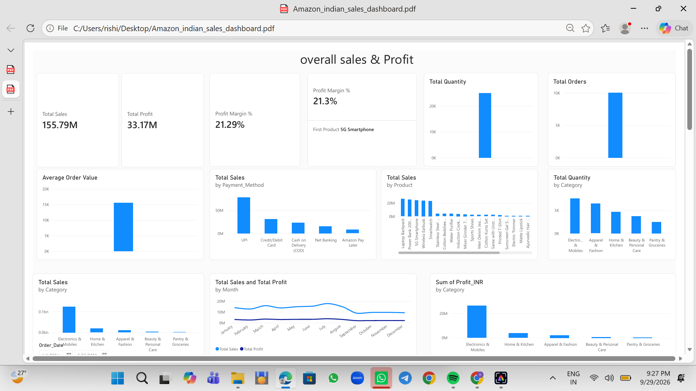
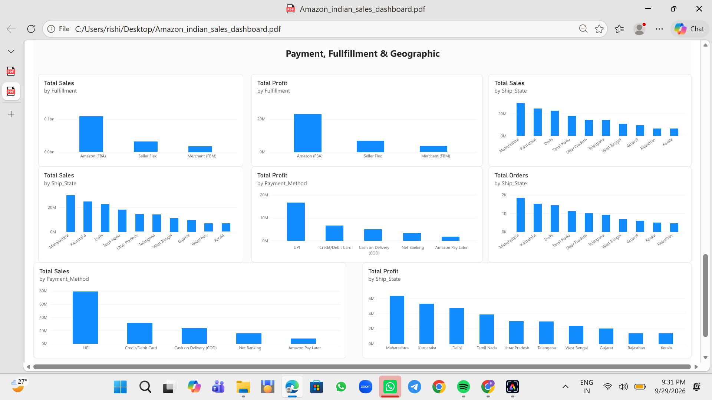
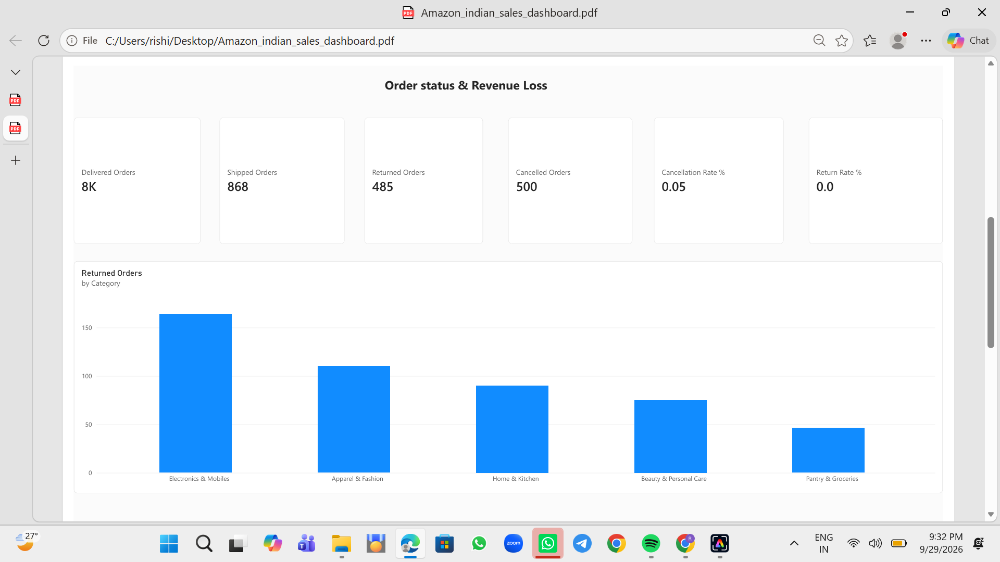

# Amazon India Sales Analysis Dashboard

An end-to-end data analytics project using **Microsoft Power BI and Excel** to analyze sales, profitability, product performance, payment methods, fulfillment channels, geographic distribution, and order status.

## Dashboard Preview

### Overall Sales and Profitability



### Payment, Fulfillment and Geographic Analysis



### Order Status and Revenue Loss



## Project Overview

This project analyzes 10,000 order records from the supplied Amazon India sales dataset. It uses an interactive Power BI dashboard to transform transactional data into meaningful business metrics and visualizations.

The goal is to identify sales patterns, understand profitability, compare product categories, and evaluate payment, fulfillment, geographic, and order-status performance.

## Key Performance Indicators

| Metric | Value |
|---|---:|
| Total Sales | ₹155.79M |
| Total Profit | ₹33.17M |
| Profit Margin | 21.29% |
| Total Orders | 10,000 |
| Total Quantity | 24,926 |
| Average Sales per Order | ₹15,578.99 |

*These metrics are calculated from the supplied dataset. They represent recorded sales and profit and should not automatically be interpreted as realized revenue or net profit.*

## Business Highlights

- **Leading category:** Electronics & Mobiles generated approximately ₹123.57M in recorded sales.
- **Leading payment method:** UPI contributed approximately ₹78.52M in recorded sales.
- **Leading state:** Maharashtra recorded approximately ₹29.55M in sales.
- **Leading fulfillment channel:** Amazon (FBA) recorded approximately ₹107.53M in sales.
- **Order outcomes:** 500 orders were cancelled and 485 were returned.

See [Business Insights](docs/BUSINESS_INSIGHTS.md) for supporting calculations, interpretations, recommendations, and limitations.

## Dashboard Features

- Overall sales, profit, and profit-margin KPIs.
- Monthly sales and profit trends.
- Product-level and category-level comparisons.
- Payment-method performance.
- Fulfillment-channel sales and profit comparisons.
- State-wise sales and profit analysis.
- Delivered, shipped, cancelled, and returned order analysis.
- DAX-based business metrics and percentage calculations.

## Tools and Technologies

- **Microsoft Power BI:** Dashboard development and data visualization.
- **Microsoft Excel:** Dataset storage and source data.
- **DAX:** KPI calculations and analytical measures.
- **Power Query:** Data preparation, where applicable.

## Repository Structure

```text
amazon-india-sales-analysis/
├── README.md
├── data/
│   └── Amazon Sales Data India.xlsx
├── dashboard/
│   └── Amazon_indian_sales_dashboard.pbix
├── screenshots/
│   ├── dashboard-overview.png
│   ├── sales-analysis.png
│   └── product-analysis.png
├── docs/
│   ├── DATA_DICTIONARY.md
│   └── BUSINESS_INSIGHTS.md
└── dax/
    └── measures.dax
```

## Getting Started

### Prerequisites

- Microsoft Power BI Desktop.
- Access to the Excel dataset included in the repository.

### Steps

1. Clone or download this repository.
2. Open `dashboard/Amazon_indian_sales_dashboard.pbix` in Power BI Desktop.
3. If prompted, update the data source path to `data/Amazon Sales Data India.xlsx`.
4. Refresh the dataset if necessary.
5. Explore the report pages, charts, and available filters.

## Documentation

- [Data Dictionary](docs/DATA_DICTIONARY.md) — Dataset fields, definitions, and data-quality checks.
- [Business Insights](docs/BUSINESS_INSIGHTS.md) — Key findings, implications, recommendations, and limitations.
- [DAX Measures](dax/measures.dax) — Core business metrics and calculations.

## Future Improvements

- Add interactive slicers and drill-through pages.
- Improve cancellation and return analysis using clearly defined denominators.
- Validate sales and profit after adjusting for cancelled and returned orders.
- Add SQL-based exploratory analysis.
- Document the data source and reproducibility steps.

## Author

**Rishika Cheldi**

GitHub: [@rishikacheldi](https://github.com/rishikacheldi)

## Data Disclaimer

The analysis describes the supplied dataset and should not be treated as an official statement of Amazon's actual business performance. Verify the dataset's provenance and redistribution permissions before sharing or reusing it.

